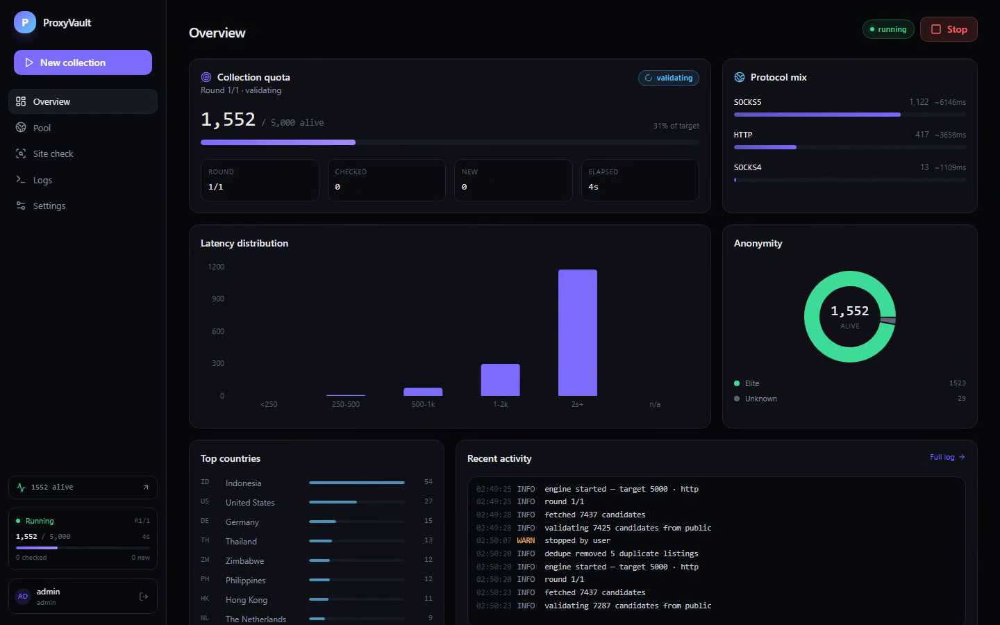

# ProxyVault

Self-hosted proxy harvesting console. Point it at a target count — it pulls
public proxy feeds, validates every candidate against live judges, keeps the
survivors, removes duplicates, enriches them with geo data, and lets you test
any URL through the resulting pool.



| | |
|---|---|
| **Backend** | Python 3.12+, FastAPI, asyncio, aiohttp, aiosqlite |
| **Frontend** | React 19, TypeScript, Vite 6, Tailwind CSS v4 |
| **Storage** | SQLite (WAL) |
| **Realtime** | Server-sent events, one frame per second |

---

## Highlights

- **Quota loop** — choose a target alive count; rounds continue until it is met
  or the round budget runs out.
- **Real validation** — two judges (httpbin + ip-api), latency measured per
  successful attempt, anonymity and HTTPS capability classified.
- **Live run everywhere** — progress, checked/new counters and elapsed time are
  visible in the sidebar on every page.
- **Automatic deduplication** — one row per `ip:port`, keeping the healthiest
  listing; runs at startup, at run start, after every round and after rechecks.
- **Site check** — pick a URL and test up to 200 alive proxies against it;
  results are stored and shown with status, latency and error.
- **Geo enrichment** — country, city and ISP via the ip-api batch endpoint.
- **Multi-user auth** — PBKDF2 (200k iterations), HttpOnly session cookies.
- **Exports** — `protocol://ip:port` text or full JSON.

## Demo

A 52-second walkthrough (login → live run → pool → site check → logs → settings):

- [`docs/proxyvault-demo.mp4`](docs/proxyvault-demo.mp4) — H.264, 1440×900
- [`docs/proxyvault-demo-poster.png`](docs/proxyvault-demo-poster.png) — poster frame

Regenerate it against a local server:

```bash
python run.py
.venv/Scripts/python.exe scripts/record_demo.py    # Windows
# source .venv/bin/activate && python scripts/record_demo.py   # macOS / Linux
```

The recorder needs Playwright Chromium (`playwright install chromium`); the
optional MP4 copy needs `pip install imageio-ffmpeg`.

## Requirements

- Python **3.12+**
- Node.js **20+** — only to rebuild the frontend (a prebuilt `web/dist` is included)
- Playwright Chromium — only for signup-gated sources and the demo recorder

## Install and run

```bash
python -m venv .venv
# Windows
.venv\Scripts\activate
# macOS / Linux
source .venv/bin/activate

pip install -r requirements.txt
python run.py
```

Open **http://127.0.0.1:8000**.

The React build in `web/dist` is served by FastAPI, so no second process is
needed. If `web/dist` is missing, the API returns a 503 with build instructions.

### Frontend development

```bash
# terminal 1
python run.py

# terminal 2
cd web
npm install
npm run dev      # http://127.0.0.1:5173, /api proxied to :8000
```

| Command | Purpose |
|---|---|
| `npm run dev` | Vite dev server with hot reload |
| `npm run build` | Production build into `web/dist` |
| `npm run typecheck` | `tsc --noEmit` |

### Docker

```bash
docker build -t proxyvault .
docker run -d --name proxyvault -p 8000:8000 \
  -e PV_ADMIN_USER=admin -e PV_ADMIN_PASS=change-me \
  -e PV_DB=/app/data/proxyvault.db \
  -v "$(pwd)/data:/app/data" proxyvault
```

The image builds the frontend in a Node stage, then serves it from Python.

## First run

1. Sign in with the bootstrap account, or create a new one from the login page.
2. Start a collection, pick a target and protocols, and watch the quota fill.
3. Open **Pool** to filter, copy, export or recheck proxies.
4. Open **Site check** to verify the pool against your own target URL.

Bootstrap credentials come from the environment:

```bash
PV_ADMIN_USER=admin
PV_ADMIN_PASS=change-me
```

They are used **only when the users table is empty**. Set a strong password
before the first start; changing the variables later does not reset an existing
admin.

Registration is open by default. To make the instance invite-only, remove
`/register` and `/api/register` from `PUBLIC_PREFIXES` in `app/main.py`.

## How it works

```
Browser ── React SPA ── /api ── FastAPI ── SQLite
                              │
                              ├── sources/public.py   12+ public feeds
                              ├── sources/custom.py   temp-mail + Playwright
                              ├── validator.py        concurrent judges
                              └── sitecheck.py        arbitrary URL tests
```

### Collection loop

1. Fetch every enabled public feed and drop entries checked in the last 30 minutes.
2. Sample down to `MAX_CANDIDATES` (12,000) to keep rounds bounded.
3. Validate at `VALIDATE_CONCURRENCY` (300) with `VALIDATE_TIMEOUT` (8 s) per judge.
4. Store successes, count a strike for known failures; three strikes mark a proxy dead.
5. Deduplicate, enrich geo data, then repeat if the target is still unmet.

Rounds after the first wait 10 minutes, because free lists rotate hourly.
Final states: `done`, `stopped`, `exhausted`.

### Deduplication

Rows are partitioned by `ip:port`. The survivor is chosen by:

1. alive before dead
2. HTTPS-capable before plain
3. lowest latency
4. most recent check

Duplicates are removed at startup, when a run starts, after every round, after a
recheck, and from **Settings → Remove duplicates**. The number removed is written
to the engine log.

### Site check

- Runs only against proxies currently marked alive.
- The request is made **through each proxy** to the URL you enter.
- Passed means the response status is below 400.
- The hard ceiling per proxy is `timeout + 2 s`, so a stalling proxy cannot hold
  the whole batch.
- Results are upserted into `site_checks` and are available from
  `GET /api/site-checks`.

### Geo enrichment

Alive proxies without a country are sent to the ip-api batch endpoint in groups
of 100, capped at `GEO_MAX` per run.

## Configuration

Environment variables:

| Variable | Default | Meaning |
|---|---|---|
| `PV_DB` | `proxyvault.db` | SQLite database path |
| `PV_ADMIN_USER` | `admin` | Bootstrap username |
| `PV_ADMIN_PASS` | `admin123` | Bootstrap password, first run only |

`app/config.py`:

| Key | Default | Meaning |
|---|---|---|
| `VALIDATE_TIMEOUT` | `8` | Seconds per judge attempt |
| `VALIDATE_CONCURRENCY` | `300` | Simultaneous validations |
| `MAX_FAILED_CHECKS` | `3` | Consecutive failures before dead |
| `MAX_CANDIDATES` | `12000` | Candidates sampled per round |
| `AUTO_DEDUPE` | `True` | Remove duplicates automatically |
| `SITE_CHECK_TIMEOUT` | `10` | Default per-proxy timeout in seconds |
| `SITE_CHECK_LIMIT` | `100` | Default proxies per site check |
| `SITE_CHECK_CONCURRENCY` | `50` | Parallel site checks |
| `GEO_ENRICH` | `True` | Enable ip-api enrichment |
| `GEO_MAX` | `2000` | Proxies enriched per run |
| `SIGNUP_SOURCES` | `[]` | Optional signup-gated source definitions |

## Signup-gated sources

Sources behind a free registration wall can be driven by the optional
temp-mail + headless Chromium flow. Define them in `SIGNUP_SOURCES`:

```python
SIGNUP_SOURCES = [{
    "name": "example",
    "signup_url": "https://example.com/register",
    "login_url": "https://example.com/login",
    "proxies_url": "https://example.com/dashboard/proxies",
    "email_verification": True,
    "verification_mode": "link",          # or "code"
    "code_selector": "input[name=code]",  # only for "code"
    "accounts": 3,
    "selectors": {
        "email": "input[name=email]",
        "password": "input[name=password]",
        "submit": "button[type=submit]",
        "proxies": ".proxy-list",
    },
}]
```

Install the browser once:

```bash
playwright install chromium
```

Keep **Signup-gated sources** enabled in the collection dialog to use them.
Sites protected by CAPTCHA are out of scope for this flow.

## API

All routes except login/register require the `pv_session` cookie.

| Method | Path | Purpose |
|---|---|---|
| `POST` | `/api/login` | Form login, sets the session cookie |
| `POST` | `/api/register` | Create an account and sign in |
| `POST` | `/api/logout` | Destroy the session |
| `GET` | `/api/me` | Current user |
| `POST` | `/api/collect` | `{target, protocols[], rounds, use_custom}` |
| `POST` | `/api/stop` | Cancel the active run or recheck |
| `GET` | `/api/status` | Snapshot including the last 150 log lines |
| `GET` | `/api/stream` | Server-sent events, one status frame per second |
| `GET` | `/api/stats` | Pool totals, protocol, anonymity, country and latency aggregates |
| `GET` | `/api/settings` | Effective runtime configuration |
| `GET` | `/api/proxies` | Filters: `protocol, country, anonymity, q, sort, offset, limit` |
| `GET` | `/api/proxies/export` | `?fmt=txt\|json`, optional `?protocol=` |
| `POST` | `/api/proxies/recheck` | Revalidate the alive pool |
| `POST` | `/api/proxies/purge-dead` | Delete dead rows |
| `POST` | `/api/proxies/dedupe` | Remove duplicate endpoints |
| `POST` | `/api/proxies/test` | Test alive proxies against a URL |
| `GET` | `/api/site-checks` | Stored site-check results |

Example:

```bash
curl -c cookies.txt \
  -d 'username=admin&password=change-me' \
  http://127.0.0.1:8000/api/login

curl -b cookies.txt \
  'http://127.0.0.1:8000/api/proxies/export?protocol=socks5' \
  -o socks5.txt
```

## Data

- `proxyvault.db` — users, sessions, proxy pool, site-check history
- SQLite runs in WAL mode with a 10-second busy timeout
- Delete the database to start over; the admin account is recreated from the
  environment on the next start

## Project layout

```
proxyvault/
├── run.py
├── requirements.txt
├── Dockerfile
├── app/
│   ├── main.py          API, auth, SSE, SPA hosting
│   ├── engine.py        collection loop, dedupe, recheck
│   ├── validator.py     concurrent proxy judges
│   ├── sitecheck.py     URL tests through proxies
│   ├── sources/
│   │   ├── public.py
│   │   └── custom.py
│   ├── security.py
│   ├── database.py
│   ├── tempmail.py
│   └── config.py
├── web/
│   ├── src/             React pages, components, API client
│   ├── dist/            production build served by FastAPI
│   └── package.json
├── scripts/
│   └── record_demo.py   demo recorder
└── docs/
    ├── proxyvault-demo.mp4
    └── proxyvault-demo-poster.png
```

## Packaging

When creating a zip for distribution, exclude generated or local-only files:

```
.venv/
web/node_modules/
**/__pycache__/
*.db
*.db-wal
*.db-shm
docs/raw/
```

Include `web/dist/` if you want the app to run without a Node build step.
Exclude the database to ship a clean instance that bootstraps the admin from
`PV_ADMIN_USER` / `PV_ADMIN_PASS` on first start.

## Troubleshooting

| Symptom | Fix |
|---|---|
| `Frontend not built` (503) | `cd web && npm install && npm run build` |
| 0 alive after a full round | Raise rounds, enable SOCKS, or run again later |
| SOCKS validation errors | `pip install aiohttp-socks` |
| Site check always fails | Free proxies often reject HTTPS `CONNECT`; try an `http://` target or another protocol |
| Signup module does nothing | Configure `SIGNUP_SOURCES` and run `playwright install chromium` |
| SSE badge reconnecting | A reverse proxy is buffering; the endpoint sends `X-Accel-Buffering: no` for nginx |

## Legal

ProxyVault aggregates proxies published openly and for free by their
maintainers. Respect each source's terms of service. Free proxies are operated
by strangers — never send credentials, personal data or anything sensitive
through them. Use the tool for legitimate testing, scraping and research.
